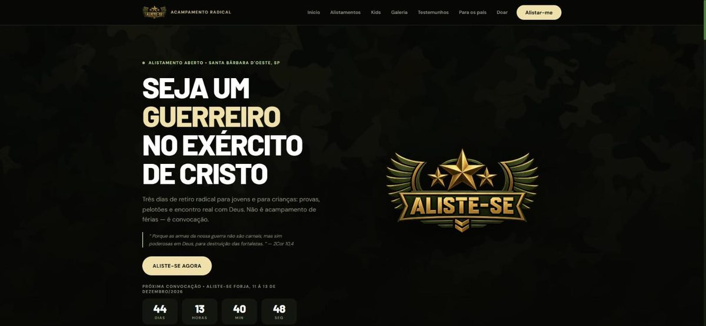
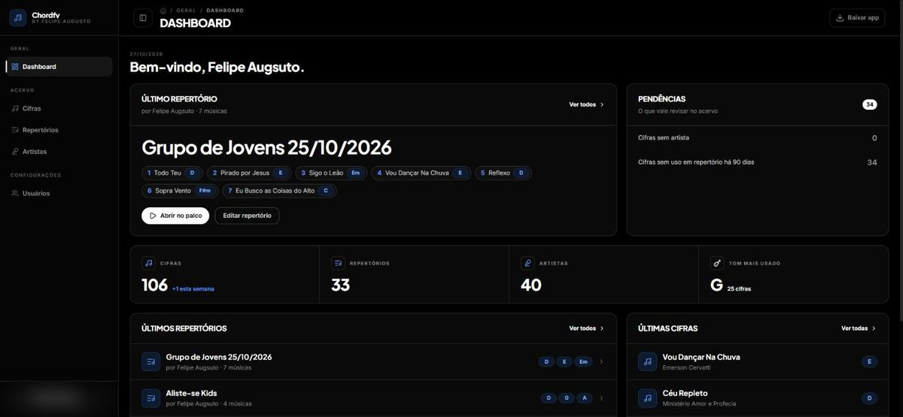
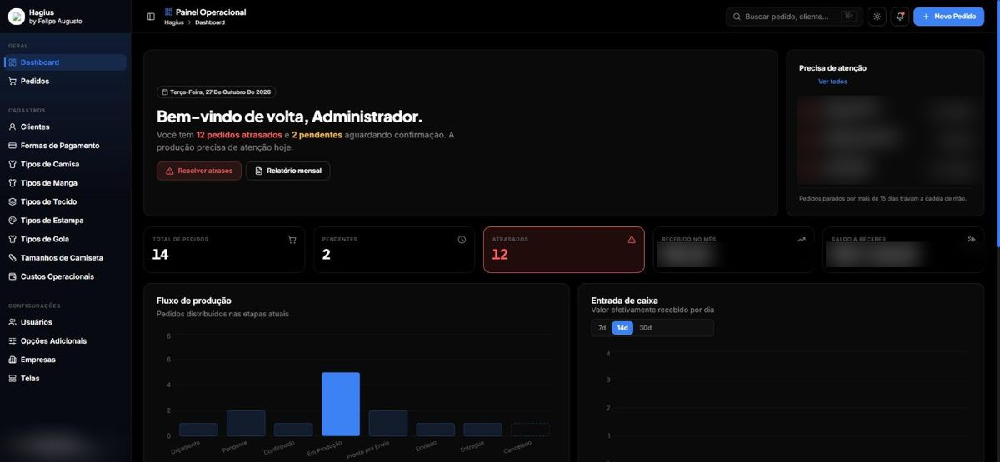
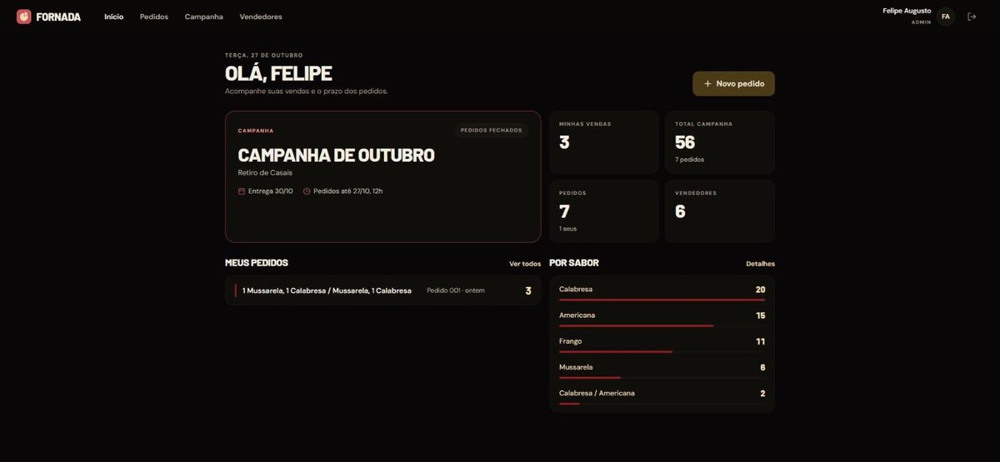
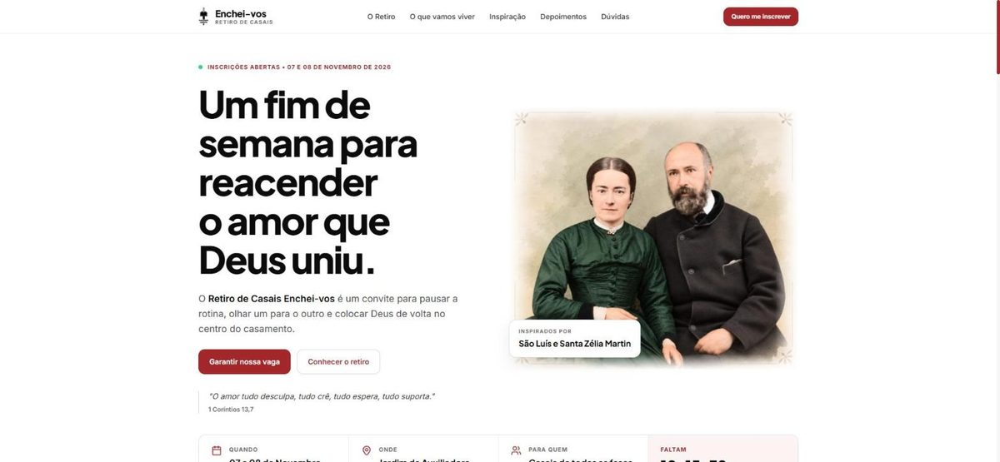

<h1>Hi, I'm Felipe 👋</h1>

  <b>Full-stack developer · Web, mobile & API integrations</b> 
  Founder of <b>Onebyte Digital</b> · Americana, SP, Brazil (UTC−3)

  
  

<h3>About me</h3>

I build complete products, from the database to the app store: web apps, Android apps and the APIs behind them. 5+ years building software professionally, nearly 5 of them in TypeScript.

<ul>
  <li>🧩 End-to-end products: <b>admin panels, dashboards, auth</b> and WhatsApp bots on webhooks</li>
  <li>📱 Shipping web + mobile from one backend with <b>React, Expo and Bun</b></li>
  <li>🇧🇷 Portuguese (native) · 🇺🇸 English (professional, async-friendly)</li>
</ul>

<h3>Tech stack</h3>

  
  
  
  
  
  
  
  
  
  
  
  
  
  
  
  
  
  

<h3>Selected work</h3>

Most of my code lives in private client repos, so here is what's live in production:

<table>
  <tr>
    <td width="50%" valign="top">
      
      <h4><a href="https://alistese.com.br">Aliste-se</a></h4>
      Registration platform for a youth retreat: public site, admin panel and mobile app on one backend. <b>400+ participants registered.</b> 
      Astro · React · Bun · Elysia · Drizzle · PostgreSQL · Expo
    </td>
    <td width="50%" valign="top">
      
      <h4><a href="https://chordfy.alistese.com.br">Chordfy</a></h4>
      Chord and setlist manager for worship bands, with drag-and-drop setlists and a stage mode for live use. 
      Elysia · Drizzle · TanStack Router · Expo · Tamagui
    </td>
  </tr>
  <tr>
    <td width="50%" valign="top">
      
      <h4><a href="https://hgintimidade.onebytedigital.com.br">HG Intimidade</a></h4>
      Sales system for an apparel business: kanban order pipeline plus a WhatsApp bot on Evolution API webhooks. 
      Bun · Elysia · Better Auth · Drizzle · dnd-kit · Recharts
    </td>
    <td width="50%" valign="top">
      
      <h4><a href="https://fornada.onebytedigital.com.br">Fornada</a></h4>
      Order system for fundraising campaigns: sellers log orders from their phones, organizers see totals by product and seller. 
      Hono · Prisma · React · Expo
    </td>
  </tr>
  <tr>
    <td width="50%" valign="top">
      
      <h4><a href="https://casaisencheivos.com.br">Enchei-vos</a></h4>
      Event site for a couples retreat, with registration, PDF generation and email confirmations. 
      TypeScript
    </td>
    <td width="50%" valign="top">
      <h4>Also built</h4>
      <b>Norte Financeiro</b>: personal finance Android app with budgets, goals and a "what's left to spend" view. Expo · Tamagui · Elysia · PostgreSQL  
      <b>PulsePad</b>: low-latency drum pad app for live shows, with a custom Kotlin native audio module. Expo · React Native · Kotlin
    </td>
  </tr>
</table>

   
  <i>Open to freelance and remote work. Feel free to reach out.</i>

